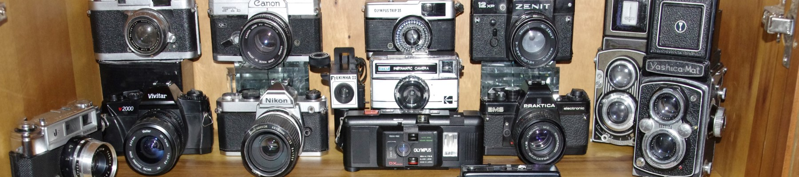

# Unit 2 - Data for Social Good Project

## Introduction

Software engineers develop programs to work with data and provide information to a user. Each user has different needs based on the information they are looking for from data. Your goal is to create a data analysis program for your user that stores and analyzes data to provide the information they need.

## Requirements

Use your knowledge of object-oriented programming, one-dimensional (1D) arrays, and algorithms to create your data analysis program:
- **Write a class** – Write a class to represent your user or business and store and analyze their data with no-argument and parameterized constructors.
- **Create at least two 1D arrays** – Create at least two 1D arrays to store the data that your user needs information about.
- **Write a method** – Write a method that finds or manipulates the elements in a 1D array to provide the information your user needs.
- **Implement a toString() method** – Write a toString() method that returns general information about the data (for example, number of values in the dataset).
- **Document your code** – Use comments to explain the purpose of the methods and code segments and note any preconditions and postconditions.

## User Story 

As an beginner photographer,
I want to know what is the best budget vintange camera,
so that I can capture nostalgic-looking photos during the beginning of my career. 

## Dataset 

Dataset: https://www.kaggle.com/datasets/crawford/1000-cameras-dataset?select=camera_dataset.csv
- **Model** (String) - name of the model
- **Release Date** (int) - release date of the camera
- **Max Resolution** (int) - max resolution of the camera in pixels
- **Weight Including Batteries** (int) - weight of the camera in grams
- **Price** (int) - price of  the camera in USD

## UML Diagram 

Put an image of your UML Diagram here. Upload the image of your UML Diagram to your repository, then use the Markdown syntax to insert your image here. Make sure your image file name is one work, otherwise it might not properly get displayed on this README. 

 

## Description 

Our user story is about an up and coming photographer who wants to purchase a cheap, beginner friendly, vintage camera to be able to capture nostalgic photos for the beginning of his career. Our chosen data set gave us 1000 cameras from the years 1996-2007, it gave us data on price, max resolution, dimensions, weight, storage, and many others. Our project addressed user goals because we traversed the data set and found the objectively best camera from each company. This not only have our user options but it showed them what a good vintage camera looked like and how it would fit in their budget. In our code we utilized 1d-arrays, text files, and for-loops to traverse our data. We also utilized the scanner class to find out which companies/brands of cameras the user wanted to look for. We would get their input using scanner.next lines and then print out all of the specs of the cameras.